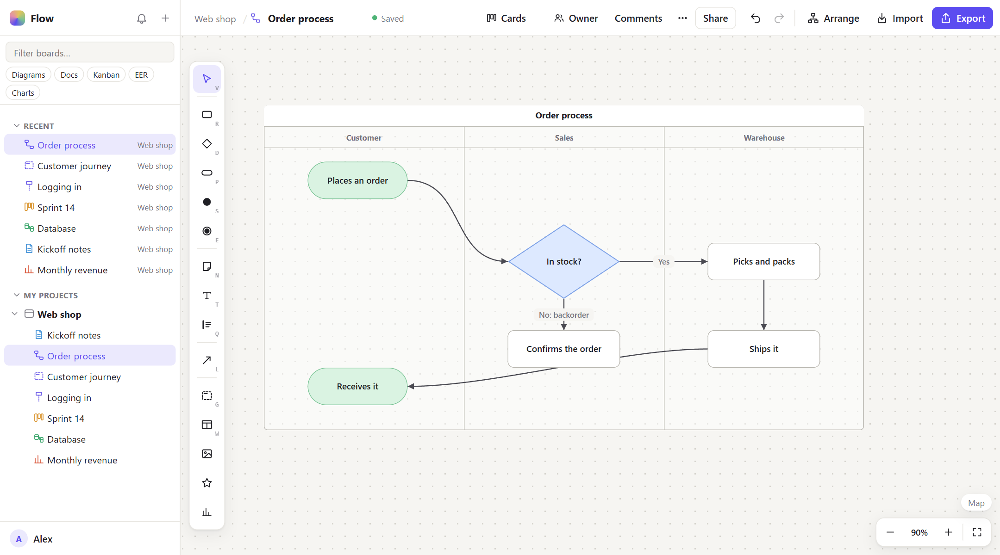
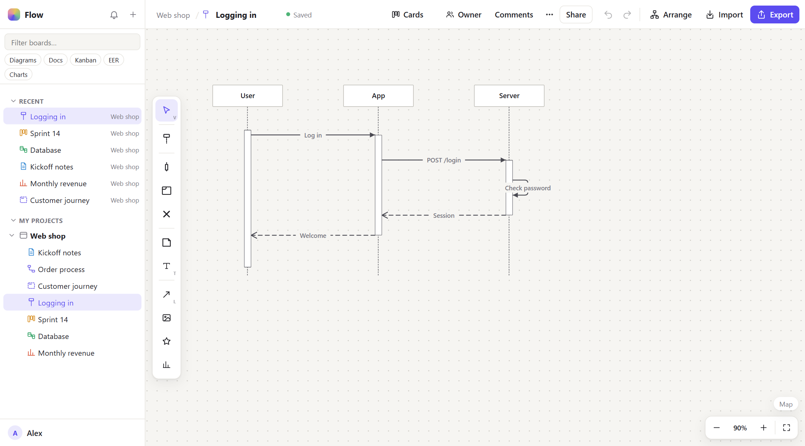
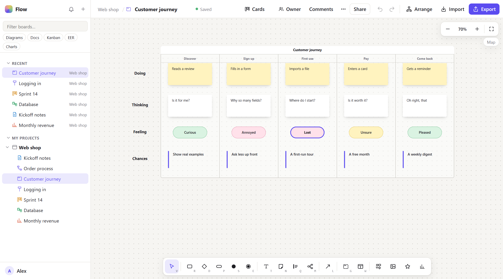
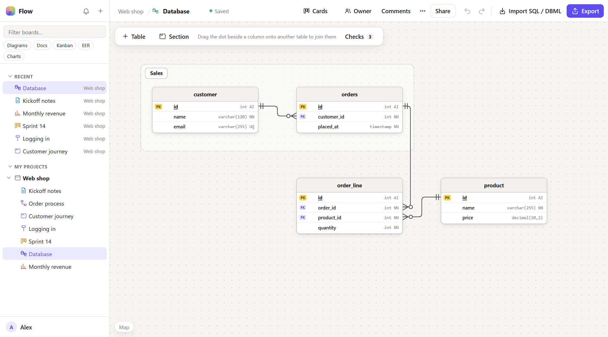
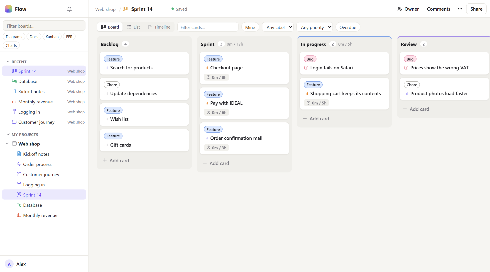
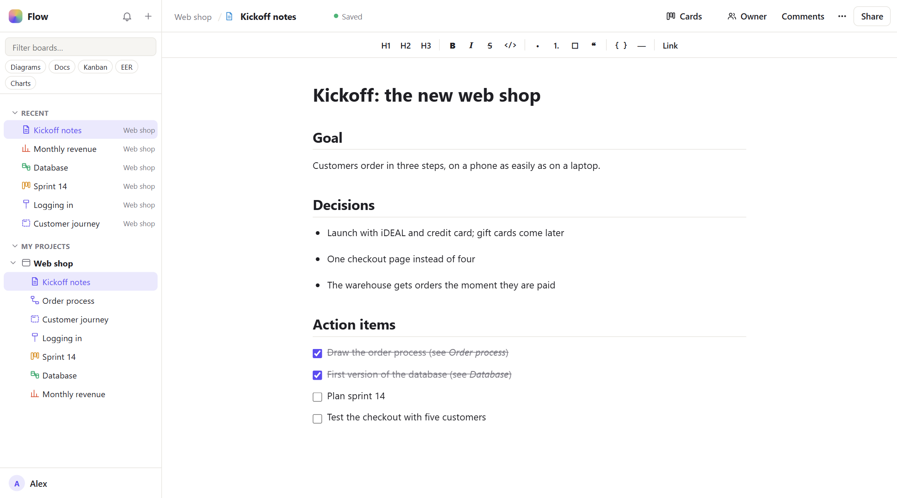
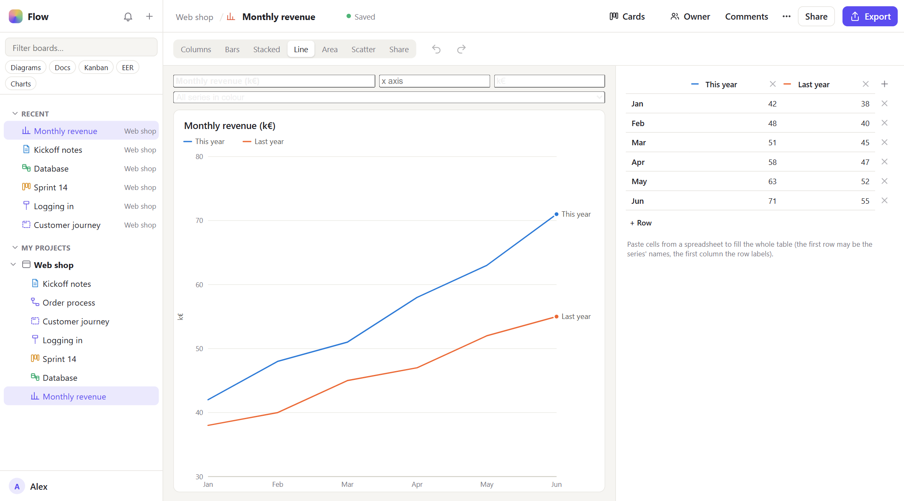

# Flow

Flow is one place for the drawings and notes around a project: flowcharts and UML diagrams,
database designs, kanban boards, charts and text documents, kept together in projects and
folders. You run it on your own computer or server, and use it in the browser or as a desktop
app for Windows and Mac. Several people can work on the same board at the same time.



The pictures here are one example project, a web shop, with a board of each kind.

## What you can make

**Diagrams.** Flowcharts, swimlanes, mind maps, whiteboards, and UML: class, sequence, state,
activity and use case diagrams. Lines route themselves around blocks, smart guides help you
line things up, and *Arrange* lays out a messy diagram for you. Export as SVG, PNG or Mermaid;
paste Mermaid, or import draw.io and Excalidraw files.



Whiteboard templates such as a customer journey give a head start:



**Database designs.** Draw tables, columns and keys, and join them by dragging one column onto
another table. Flow writes the SQL for PostgreSQL, MySQL, SQLite, SQL Server and Oracle, and
reads existing SQL (also `pg_dump` and `mysqldump`) or DBML back into a diagram. Checks point out
problems in the schema.



**Kanban boards.** Columns and cards with labels, priorities, dates, subtasks, estimates and a
timer. Look at the same cards as a board, a list or a timeline, and link a card to the diagram or
table it is about.



**Documents.** Text documents with headings, lists and checklists, stored as Markdown.



**Charts.** Columns, bars, lines, areas, scatter and share charts from a small table of numbers;
paste the cells straight from a spreadsheet.



**Templates.** Start from an org chart, customer journey, fishbone, retrospective, scrum board,
bug tracker, web shop schema, meeting notes and more, or save your own.

## Working together

- **Share** a project or a single board with people as viewer, commenter or editor, or publish a
  board through a link that also works for guests without an account.
- **Edit at the same time.** Everyone on a board sees each other's cursors and changes as they
  happen. Undo only undoes your own changes.
- **Comment** on a board, a block, a table, a card or a spot; reply and resolve.
- **Version history.** Look at an older version of a board and what changed since.
- **Present.** Sections of a board become slides.

## Getting Flow

Flow has no central service: you run the server yourself, and your data stays with you.

**Try it** (needs [Docker](https://www.docker.com/products/docker-desktop/)):

```bash
git clone https://github.com/jochem11/flow.git
cd flow
docker compose up --build
```

Then open http://localhost:8080 and sign up. A new account starts with a *Welcome to Flow*
project that has one board of each kind. In this setup mails (the sign-up confirmation, password
resets, invitations) are not sent but written to the `outbox` folder.

**Run it for real**, for yourself or a team: see [Development and production](#development-and-production)
below. `prod.env.example` lists the settings (address, mail, Google sign-in), and Flow can be
reached from other devices through a private network such as Tailscale, a Cloudflare Tunnel, or
any proxy with https.

**The desktop app** for Windows and Mac is on the [Releases](https://github.com/jochem11/flow/releases/latest)
page. It is the same Flow in its own window, and it offers to update itself when there is a
newer version. The released builds start out pointing at the author's own server: on the login
screen, open *Server* at the bottom and fill in the address of yours. They are not signed with a paid
certificate, so Windows asks *More info → Run anyway* and macOS *System Settings → Privacy &
Security → Open Anyway* the first time.

## For developers

```
crates/flow-core   the documents (models) and everything made from them: SQL for 5 databases,
                   Mermaid, SVG/PNG, auto-layout, SQL import
server             Rust (Axum + PostgreSQL): accounts, projects and boards, rights, invites,
                   share links, comments, editing together (WebSocket, Yjs), and the web version
src-tauri          the desktop app (Tauri 2): a window for the same frontend, the tools from
                   flow-core run locally, the session token in the system keychain
src                the frontend (SolidJS), for the desktop app and the web version alike
```

## Running it locally

Needs Rust, Node and PostgreSQL (or Docker, see below).

```bash
npm install
createdb flow
cp server/.env.example server/.env       # set DATABASE_URL; mail goes to server/outbox
(cd server && cargo run)                 # the server, on http://localhost:8080
npm run dev                              # the web version on http://localhost:1420 (talks to the server)
npm run app:dev                          # the desktop app, Flow Dev (talks to http://localhost:8080)
```

The desktop app uses `VITE_SERVER_URL` (default `http://localhost:8080`); its login
screen can switch to another server. Projects the desktop app kept on disk before
accounts existed can be uploaded from the account menu (bottom left): *Upload projects
from this computer*. The files stay where they are.

## Settings (server)

All from environment variables or `server/.env` (see `server/src/config.rs`):

| Variable | |
|---|---|
| `DATABASE_URL` | `postgres://…` (required); tables are created and updated on start |
| `PUBLIC_URL` | where people reach the server; used in mails and links (default `http://localhost:8080`) |
| `WEB_DIR` | the web build to serve (`npm run build` → `dist`) |
| `ALLOWED_ORIGINS` | other origins that may call the API (the desktop app, the Vite dev server) |
| `GOOGLE_CLIENT_ID`, `GOOGLE_CLIENT_SECRET` | Google sign-in (off when not set) |
| `SMTP_HOST`, `SMTP_PORT`, `SMTP_USER`, `SMTP_PASSWORD`, `MAIL_FROM` | sending mail |
| `MAIL_OUTBOX` | write mails to this folder instead (development) |
| `TRUST_PROXY` | `1` behind a proxy that sets `X-Forwarded-For` (Caddy, a tunnel): rate limits per client address |

### Google sign-in

1. In the [Google Cloud console](https://console.cloud.google.com/apis/credentials): *Create
   credentials → OAuth client ID → Web application*.
2. *Authorized redirect URI*: `<PUBLIC_URL>/api/auth/google/callback`
   (e.g. `http://localhost:8080/api/auth/google/callback`).
3. Set `GOOGLE_CLIENT_ID` and `GOOGLE_CLIENT_SECRET`. The login screen then shows
   *Continue with Google*. The desktop app opens the browser for it and gets the session
   back on a local port.

An account made with a password and a Google account with the same (verified) address
become one account.

### Mail

Sign-up confirmations, password resets, invitations and access requests are sent over
SMTP (any provider: Resend, Mailgun, Postmark, Gmail…). Without `SMTP_HOST`, mails go to
`MAIL_OUTBOX` as JSON files, or only to the log.

## Development and production

Two of everything, side by side on one computer:

| | Development | Production |
|---|---|---|
| Desktop app | **Flow Dev** (`nl.jochem.flowapp.dev`, links `flowapp-dev://`) | **Flow** (`nl.jochem.flowapp`, links `flowapp://`) |
| Its server | `http://localhost:8080` (`.env.development`) | `VITE_SERVER_URL` in `.env.production` |
| Server | `docker-compose.yml` + `.env`, or `cargo run` + `server/.env` | `docker-compose.prod.yml` + `prod.env` |
| Mail | to `./outbox` until `SMTP_HOST` is set | SMTP (required) |
| Database | its own | its own (`flow-prod`, apart from development's) |

Flow and Flow Dev each keep their own local projects, settings and sign-in.

```bash
npm run start:dev            # all of development at once: the server in Docker + Flow Dev
npm run start:dev:web        # the same with the web version (http://localhost:1420)
npm run app:dev              # Flow Dev, live reloading, against localhost:8080
npm run app:build:dev        # Flow Dev as an installable app
npm run app:build            # Flow for production (set VITE_SERVER_URL in .env.production first)

npm run server:dev           # the server + PostgreSQL in Docker, on http://localhost:8080
cp prod.env.example prod.env # once: passwords, mail, address (see the comments in it)
npm run server:prod          # the production server in the background, on http://localhost:8090
npm run server:prod:logs     # whether mail and Google sign-in are on
npm run server:prod:stop
```

### Releasing the desktop app

GitHub builds Flow for Windows and Mac (`.github/workflows/desktop-app.yml`) when a tag
with the new version is pushed, and puts the installers on a release:

```bash
git tag app-v0.2.1 && git push origin app-v0.2.1
```

An installed Flow looks at the latest release when it starts and offers *Update and restart*
(`src/lib/version.ts`). Updates are signed: the private key is the repository secret
`TAURI_SIGNING_PRIVATE_KEY`, its public half is in `src-tauri/tauri.conf.json`. Without that
key no installed app accepts an update any more, so keep a copy of it.

To reach production from the internet: set `PUBLIC_URL` to its `https://` address
(cookies are then secure) and either turn on the Cloudflare Tunnel in `prod.env`
(no ports to open, works on this Mac and in the cloud alike) or put a TLS proxy
in front (Caddy, nginx) that also passes WebSockets (`/api/ws/…`). Everything,
uploaded files included, is in PostgreSQL, so backing up is one `pg_dump`:

```bash
docker compose -p flow-prod exec -T db pg_dump -U flow flow > flow-backup.sql
```

## Rights

Roles, in order: *viewer* < *commenter* < *editor* < *co-owner* < *owner*. A co-owner can do
everything the owner can (also invite and remove people), except delete the project or change
the owner. Someone's role on a board is:

1. the owner or a co-owner of the project: that;
2. else the board's own role for them, if it has one (also *No access*, which hides the board);
3. else their role in the project;
4. a board's link can raise that to its own setting (*can view* / *can comment*) for anyone
   who has it, guests included, but never lowers it.

So someone can edit one board and only view another: in the project's *People* dialog, *Per
board* next to a person sets their role on each board.

Invitations always ask: the person gets a mail saying what they will be able to do, and gets
access only when they accept (on the invitation's page, or in the app). The one who invited them
gets a mail with the answer.

All of that is decided in one place, `server/src/access.rs`; every request and the
co-editing WebSocket go through it. The app hides what you cannot do (`src/lib/access.ts`),
and the server refuses it anyway.

## Editing together

While a board from the server is open, its content also lives in a shared Yjs document,
synced through the server (`server/src/collab.rs`, y-websocket protocol). The editors keep
working on their own stores; `src/lib/collab/` mirrors them into the shared document item
by item and field by field, so two people changing different things both keep their
change, and moving an item never loses or doubles it. Undo only undoes your own changes.
Text documents use Tiptap's collaboration extension. Changes from viewers, commenters and
guests are dropped by the server.

## Tests

```bash
npm test                                                     # frontend (Vitest)
cargo test -p flow-core -p flowapp                           # documents, exports, imports; desktop app
DATABASE_URL=postgres://<user>@localhost/postgres cargo test -p flow-server   # the API, on a fresh database per test
```

Rules that exist in both TypeScript and Rust (line routing, sequence activations, UML rows)
have shared cases in `fixtures/`, checked by both sides.

## Types between Rust and TypeScript

`src/bindings.ts` is generated from the Rust models (`crates/flow-core/src/models/`) and the
desktop commands (`src-tauri/src/commands/`) by tauri-specta: `npm run bindings` (also on
`npm run tauri dev`). Never edit it by hand. The server's API uses the same types.

## Code map

```
crates/flow-core/src/
  models/            project, document, flow, text, kanban, eer, access (roles, comments)
  uml/               UML class rows (Mermaid and SVG read them)
  eer.rs             EER → SQL                 sql_import.rs  SQL → EER
  dbml.rs            EER ↔ DBML (dbdiagram.io)
  mermaid.rs         documents → Mermaid       flow.rs        layout, export files
  flow_svg.rs        flowchart → SVG           folders.rs     the folder tree
server/src/
  auth.rs            sessions, password, Google, mail links
  access.rs          who may do what
  collab.rs          rooms for editing together
  routes/            projects, documents, members (invites), sharing (links, guests),
                     comments, history (versions), templates, files (images),
                     tools (flow-core for the web version)
  migrations/        the database tables
src/lib/
  api.ts, server.ts  talking to the server (and to the desktop app's own Rust)
  auth.ts, route.ts  logging in; paths and links (also into the desktop app)
  workspace.ts       projects, the open board, autosave
  access.ts          what you may do with the open board
  comments.ts        comments on the open board
  collab/            editing together
  store/, eer.ts, kanban.ts   the editors' state (store/clipboard.ts: copy and paste)
  snapping.ts        smart guides            planning.ts  dates, priority, blocked, filters
  eerChecks.ts       schema checks           mindmap.ts   mind map topics and their layout
  history.ts         version history         present.ts   presenting sections
  files.ts           images on boards
src/templates/       the built-in templates
src/components/      Gate (login, link pages), Sidebar, TopBar, the editors, ShareDialog,
                     Comments, Presence, and the dialogs for exports and imports
```
